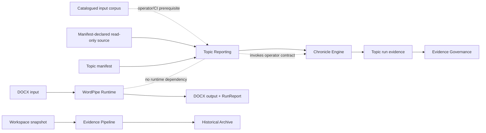
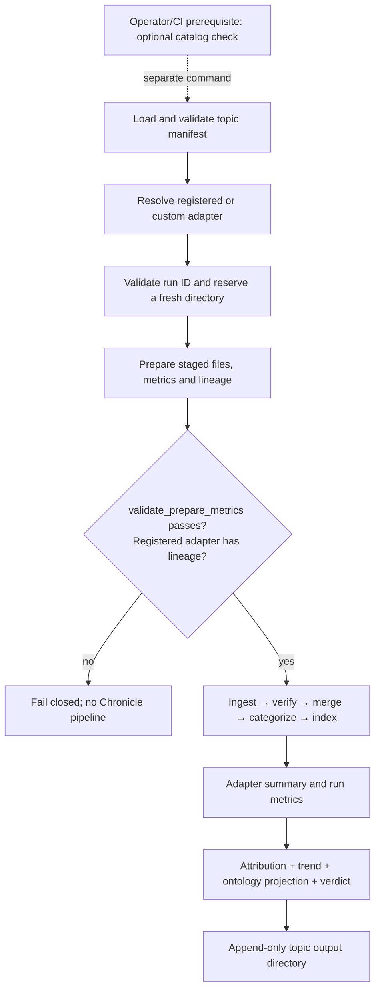
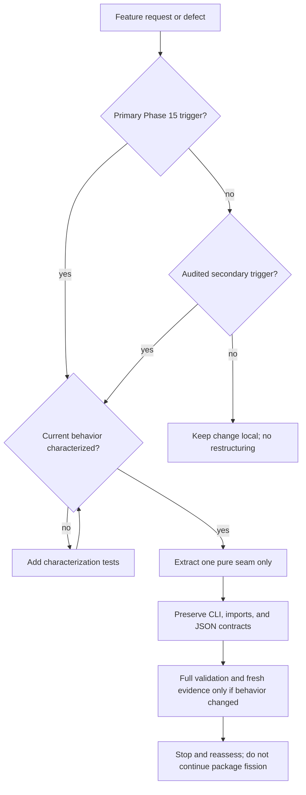

# Architecture, Modules & Integration Reference

> **Purpose:** Comprehensive reference documenting all three subsystems — their architecture, module responsibilities, data flow, logic flow, goals, and constraints.
> **Date:** 2026-02-14 (Jalali: 1404-11-25)
> **Last Updated:** 2026-07-26 (Jalali: 1405-05-04)
> **Supersedes:** `docs/architecture/PROJECT_SUMMARY.md`, `docs/TOOLS_MODULES_INTEGRATION_REPORT.md`, `docs/INTEGRATION_MAP_BEFORE_AFTER.md`

---

## Table of Contents

1. [System Overview](#1-system-overview)
2. [Subsystem A: Chronicle Pipeline (`pipeline/`)](#2-subsystem-a-chronicle-pipeline-pipeline)
   - 2.1 [Architecture](#21-architecture)
   - 2.2 [Modules](#22-modules)
   - 2.3 [Data Flow](#23-data-flow)
   - 2.4 [Logic Flow](#24-logic-flow)
   - 2.5 [Goals & Constraints](#25-goals--constraints)
3. [Subsystem B: Evidence Pipeline (`tools/`)](#3-subsystem-b-evidence-pipeline-tools)
   - 3.1 [Architecture](#31-architecture)
   - 3.2 [Modules](#32-modules)
   - 3.3 [Data Flow](#33-data-flow)
   - 3.4 [Logic Flow](#34-logic-flow)
   - 3.5 [Goals & Constraints](#35-goals--constraints)
4. [Subsystem C: WordPipe Runtime (`wordpipe/`)](#4-subsystem-c-wordpipe-runtime-wordpipe)
   - 4.1 [Architecture](#41-architecture)
   - 4.2 [Modules](#42-modules)
   - 4.3 [Data Flow](#43-data-flow)
   - 4.4 [Logic Flow](#44-logic-flow)
   - 4.5 [Goals & Constraints](#45-goals--constraints)
5. [Cross-Subsystem Integration](#5-cross-subsystem-integration)
6. [Shared Contracts](#6-shared-contracts)
7. [Verification & Testing](#7-verification--testing)
8. [Appendix: Directional Architecture Evidence](#8-appendix-directional-architecture-evidence)

---

## 1. System Overview

This repository contains **three independent subsystems**, each with its own purpose, architecture, and lifecycle:

| Subsystem | Directory | Purpose | Interface Type | Primary Audience |
|-----------|-----------|---------|----------------|-----------------|
| **Chronicle Pipeline** | `pipeline/` | Automated chronicle ingestion → merging → categorization → indexing | CLI (PowerShell + Python) | Operator, Historian |
| **Evidence Pipeline** | `tools/` | Archival, legacy reorganization, integrity verification | CLI (Python) | Operator, Auditor |
| **WordPipe Runtime** | `wordpipe/` | DOCX processing library for TraceLedger embedding | Library (Python import) | Engineer, TraceLedger |
| **Topic Report Runner** | `tools/run_topic_report.py`, `tools/prepare_*_chronicle.py`, topic folders | Convert non-Chronicle Markdown bundles into staged Chronicle events, run the pipeline, compare trends, and emit ontology evidence | CLI (Python + pipeline) | Operator, Researcher |

Current Chronicle split: reusable Chronicle logic lives under `wordpipe/chronicle/`;
`pipeline/` is the operator CLI/config surface.

Current topic-runner evidence: the InsuranceChatbot manifest resolves the first
registered adapter, converts commit history, project digest, and roadmap
Markdown into staged Chronicle input, runs `pipeline/chain.ps1`, and emits
metrics/trends/source attribution/ontology evidence. Run
`WordHorrorStories/insurancechatbot/output/phase13_trend_validation/` produced
200 staged/merged events, 194 events with theme tags, 0 warnings/errors, and a
trend comparison against `phase13_baseline_validation`.

### Core Design Principles (All Subsystems)

1. **Copy-only, non-destructive** — No stage modifies its inputs in place
2. **Deterministic outputs** — Same inputs + same config = same outputs (idempotent)
3. **Backward compatibility** — CLI flags and contracts are preserved across versions
4. **Graceful fallbacks** — Missing optional dependencies (Jinja2, YAML) degrade gracefully
5. **Audit trail** — Append-only logs for historical evidence; replace-on-run reports for current state
6. **Root ownership** — Governance/configuration only at root; generated output
   goes to `_WORK/` and curated evidence to `_ARCHIVE/evidence/` as defined in
   `ROOT_ORGANIZATION.md`.

Current alignment debt is tracked in
`docs/engineering/IMPLEMENTATION_ALIGNMENT_AUDIT.md`. The principal modular
follow-ups are conditional decomposition of the topic runner, separately
deferred canonical extraction of the index stage, and project-level mapping of
topic-run ontology instances.

### 1.1 Domain-to-subsystem crosswalk

The bounded domains below describe ownership without replacing or renumbering Subsystems A, B, and C. Domains are responsibility boundaries; they are not a prescription for one package per domain.

| Bounded domain | Existing architecture location | Current ownership |
|----------------|--------------------------------|-------------------|
| Corpus Governance | Cross-cutting support domain | `inputs/`, `inputs/catalog.json`, and `tools/check_input_catalog.py`; input may instead be another manifest-declared read-only topic source |
| Chronicle Engine | Subsystem A | `wordpipe/chronicle/` and operator stages in `pipeline/`; `wordpipe.chronicle.index` owns reusable index logic, with `pipeline/index.py` retaining the operator CLI and compatibility exports |
| Topic Reporting | Topic Report Runner entry and Subsystem A integration | Runner, topic adapters, manifests, themes, and run-evidence schemas |
| Evidence Governance | Subsystem B plus root policy | Layout, append-only retention, collision policy, integrity, documentation-link, and security checks |
| WordPipe Runtime | Subsystem C | Importable DOCX runtime, interfaces, adapters, steps, and orchestration |
| Historical Archive | Supporting evidence boundary, not a subsystem | `_ARCHIVE/`, `_WORK/snapshot/`, and `_META/`; never an active import surface |

`WordHorrorStories/<topic>/` is an active Topic Reporting workspace containing manifests, themes, topic documentation, and run evidence. It is not part of the Historical Archive. Topic Reporting owns schemas such as `run_metrics.json`, `source_attribution.json`, and `topic_run_ontology.json`; Evidence Governance owns their placement, collision protection, append-only retention, and the rule that historical runs are never rewritten.

A topic source may be a catalogued `inputs/<corpus>/<format>/` path or another manifest-declared read-only source such as `_ARCHIVE/pipeline-chronicle/`. This ownership model does not itself require a source move.

### 1.2 Required capabilities and logical flow

| Capability | Current owner |
|------------|---------------|
| Catalog, hash, and classify active corpus inputs | Corpus Governance |
| Validate a manifest and resolve its adapter | Topic Reporting |
| Translate source-native structure into staged events and lineage | Topic adapter |
| Validate preparation metrics and registered-adapter lineage | `validate_prepare_metrics` in Topic Reporting |
| Validate a run ID and reserve a safe append-only run directory | `validate_run_id` and `run_report` |
| Ingest, verify, merge/deduplicate, categorize, and index | Chronicle Engine |
| Summarize metrics and output inventory | Topic adapter/reporting contract |
| Produce attribution, trends, ontology projection, and verdict | Topic Reporting |
| Enforce layout, input integrity, links, security, and evidence preservation | Evidence Governance |
| Read, flatten, style, segment, finalize, and update a DOCX TOC | WordPipe Runtime |

The input catalog is an operator/CI prerequisite, not a stage inside `run_topic_report.py`:



The observed topic-run lifecycle is:



Run reservation is implemented behavior, not an aspirational policy: `validate_run_id` rejects unsafe directory names, and `run_report` rejects an existing directory before reserving a real-run directory with `mkdir(..., exist_ok=False)`.

### 1.3 Separation-of-concerns rules

Machine-enforced v1 import boundaries are implemented by `tools/check_architecture_boundaries.py`:

- `wordpipe` must not import `tools`, `pipeline`, `WordHorrorStories`, or `_ARCHIVE`.
- `wordpipe.core` and `wordpipe.interfaces` must not import adapters, orchestration, Chronicle, or tools.
- `wordpipe.chronicle` must not import topic adapters, `run_topic_report`, or DOCX runtime adapters.

The checker scans production Python under `wordpipe/` and `pipeline/` with `ast`, excludes tests, legacy/archive/generated trees, and imports guarded solely by `TYPE_CHECKING`, and records six reviewed composition-root and compatibility-wrapper path roles in one registry. Those roles are not active v1 bypasses: none currently suppresses a forbidden edge. `tools/`, including the topic runner and adapters, remains outside the v1 AST scan; its import hygiene is governed by policy and characterization tests. Static AST inspection cannot see `importlib`, subprocess execution, plugin entry points, or test-time dynamic loading; it is an import-boundary guard, not a complete call graph or security proof.

More detailed inward-layer rules for `wordpipe.steps` remain documentation-only in v1. Do not add them to CI until a fresh import inventory and focused fixtures establish a green, low-false-positive baseline.

The following design rules are documented constraints rather than broader automated enforcement:

- Topic adapters translate inputs; they do not own trend comparison, verdicts, ontology projection, or retention policy.
- Chronicle code remains topic-neutral and does not discover manifests or run IDs.
- Operator CLIs delegate to domain logic and do not become application import surfaces.
- Ontology entities do not automatically become Python modules.
- Compatibility facades are intentional and are not duplication evidence by themselves.
- A feature, schema migration, and package/filesystem move cannot share one slice.
- Historical evidence is not rewritten to reflect a newer architecture.

Explicit non-goals for this stability slice are: no `tools/topic_report/`, no adapter-helper package, no ontology emission expansion or NLP, no move of `pipeline/index.py`, and no production module move, rename, or public-contract change.

### 1.4 Refactor eligibility gate

> Broad topic-runner decomposition is conditional, not an active Project Phase 15 deliverable. Reconsider it only when a third adapter exposes concrete coupling or ontology schema evolution makes the current serializer unsafe.

The two conditions in that sentence are the primary triggers. The following are secondary supporting triggers and are insufficient when observed only once:

1. The same defect requires synchronized edits across multiple production modules on two separate occasions.
2. A checked dependency violation cannot be repaired locally.
3. A public contract cannot evolve safely inside its current owner despite characterization tests.

The repeated-defect trigger is valid only when `JOURNAL.md` or `docs/engineering/IMPLEMENTATION_ALIGNMENT_AUDIT.md` records the date and defect, affected production paths, first and second occurrence, why synchronized edits were required, and tests demonstrating the shared responsibility.



Current gate decisions are intentionally conservative: broad runner decomposition is blocked; shared adapter utilities are blocked until a third adapter or an audited repeated defect; ontology-projector or verdict extraction is blocked until serializer/schema pressure; WordPipe restructuring is not justified because its current layering is already the target pattern.

---

## 2. Subsystem A: Chronicle Pipeline (`pipeline/` → `wordpipe.chronicle/`)

**Canonical source decision:** See `docs/engineering/CHRONICLE_CANONICAL_DECISION.md`.
Reusable Chronicle logic for ingest, verify, merge, and categorize now lives in
`wordpipe.chronicle.*`; `pipeline/` retains operator wrappers, configuration,
templates, `chain.ps1`, and the deferred `index.py` stage. `tools/pipeline-chronicle/`
is a legacy/reference CLI location with wrappers where canonical modules exist.

### 2.1 Architecture

The chronicle pipeline is a **5-stage CLI pipeline** that transforms raw ChatGPT incident markdown files into a tagged, indexed, cross-referenced chronicle.

With a topic manifest and preparation adapter, the same 5-stage pipeline can
process other long Markdown topics. The adapter's job is to convert
source-native structures (commit headings, roadmap phases, chapters, cases,
lessons, or notes) into Chronicle-compatible dated events. The generic runner
then records metrics, trend deltas, source attribution, and ontology evidence
around `pipeline/chain.ps1`.

**Architecture pattern:** Pipe-and-filter, each stage reads from the previous stage's output.

**Entrypoint:** `pipeline/chain.ps1` (one-command PowerShell wrapper)

**NOTE - File locations:** `wordpipe.chronicle` is the canonical import surface.
`pipeline/` and `tools/pipeline-chronicle/` are CLI/operator compatibility
surfaces, not runtime import surfaces. `index.py` is the remaining Chronicle
stage deferred from canonical extraction.

```
┌─────────┐    ┌──────────┐    ┌───────┐    ┌────────────┐    ┌───────┐
│ Ingest  │───▶│ Verify   │───▶│ Merge │───▶│ Categorize │───▶│ Index │
│ Stage 1 │    │ Stage 2  │    │Stage 3│    │  Stage 4   │    │Stage 5│
└─────────┘    └──────────┘    └───────┘    └────────────┘    └───────┘
     │              │              │               │               │
     ▼              ▼              ▼               ▼               ▼
 normalised/    verification    merged.md      chronicle_       appendix/
 *.md            report                       tagged.md        *.md
                                              + sidecar.json
```

```
┌─────────┐    ┌──────────┐    ┌───────┐    ┌────────────┐    ┌───────┐
│ Ingest  │───▶│ Verify   │───▶│ Merge │───▶│ Categorize │───▶│ Index │
│ Stage 1 │    │ Stage 2  │    │Stage 3│    │  Stage 4   │    │Stage 5│
└─────────┘    └──────────┘    └───────┘    └────────────┘    └───────┘
     │              │              │               │               │
     ▼              ▼              ▼               ▼               ▼
 normalised/    verification    merged.md      chronicle_       appendix/
 *.md            report                       tagged.md        *.md
                                              + sidecar.json
```

### 2.2 Modules

#### `wordpipe.chronicle.ingest` - Stage 1: Ingestion
- **Purpose:** Convert raw deep-search markdown into normalised format with YAML front-matter
- **Location:** canonical module under `wordpipe/chronicle/`; CLI wrappers in `pipeline/` and `tools/pipeline-chronicle/`
- **Input:** Raw `.md` files from `inputs/chatgpt-chronicle/markdown/`
- **Output:** Normalised `.md` files with `source`, `title`, `date`, `event_count` in YAML front-matter
- **Key functions:**
  - `clean_mojibake(text)` — Fixes common Unicode corruption patterns
  - `extract_source_name(filename)` — Derives source name from filename or CLI override
  - `extract_title(text)` — Extracts title from H1, H2, or source fallback
  - `find_dates(text)` — Finds ISO and named-month dates
  - `parse_date_range(date_str)` — Parses "YYYY-MM-DD to YYYY-MM-DD" ranges
  - `extract_preamble(text)` — Extracts text before the first event
  - `split_into_events(text)` — Splits chronicle text into individual events by date headers
  - `format_event(event)` — Formats a single event into standard markdown
  - `generate_normalised_md(input_path, output_path)` — Full pipeline for one file
- **CLI flags:** `--input`, `--output`, `--source-name`, `--verbose`
- **Error handling:** Non-zero exit on write failure; logged warnings for malformed input

#### `wordpipe.chronicle.verify_ingest` - Stage 2: Verification (optional)
- **Purpose:** Verify that all input files can be successfully ingested
- **Location:** canonical module under `wordpipe/chronicle/`; CLI wrappers in `pipeline/` and `tools/pipeline-chronicle/`
- **Input:** Directory of raw `.md` files, path to `ingest.py`
- **Output:** Report of which files pass/fail ingestion
- **Key functions:**
  - `verify_directory(raw_dir, ingest_script)` runs ingest on each input in a temporary directory, reads accepted counts from normalized front matter, and reports diagnostics from stdout and stderr.
- **CLI flags:** `--dir`, `--ingest`, `--verbose`
- **Integration:** Only runs when `chain.ps1 -Verify` is used

#### `wordpipe.chronicle.merge` - Stage 3: Merge
- **Purpose:** Merge N normalised MD files into one, deduplicating by body hash + date
- **Location:** canonical module under `wordpipe/chronicle/`; CLI wrappers in `pipeline/` and `tools/pipeline-chronicle/`
- **Input:** Directory of normalised `.md` files
- **Output:** `merged.md` (merged chronicle), `merged.duplicates.json` (duplicate report), `merged.source_coverage.md` (source attribution)
- **Key functions:**
  - `parse_yaml_frontmatter(text)` — Extracts YAML front-matter blocks
  - `extract_events(text)` — Extracts event blocks with metadata
  - `compute_body_hash(text)` — SHA256 of whitespace-normalized body
  - `merge_files(input_dir, output_path, conflict_mode)` — Main merge orchestrator
  - `generate_source_coverage(events, output_path)` — Writes source attribution markdown
- **CLI flags:** `--input-dir`, `--output`, `--conflict-mode` (keep-both|skip|overwrite), `--verbose`
- **Conflict modes:**
  - `keep-both`: Preserves all variants, appends `(1)`, `(2)` to duplicate titles
  - `skip`: Skips exact hash+date duplicates, keeps first occurrence
  - `overwrite`: Replaces with last-seen variant
- **Duplicates report:** JSON with `duplicate_groups` array, each containing `canonical` and `duplicates` entries

#### `wordpipe.chronicle.categorize` - Stage 4: Categorization
- **Purpose:** Tag each event with theme keywords using positive + negative matching
- **Location:** canonical module under `wordpipe/chronicle/`; CLI wrappers in `pipeline/` and `tools/pipeline-chronicle/`
- **Input:** `merged.md` from Stage 3
- **Output:** `chronicle_tagged.md` (with `<!-- themes: ... -->` inline comments), `chronicle_tagged.tagged.json` (sidecar JSON)
- **Key functions:**
  - `load_themes(config_path)` — Loads theme definitions from JSON or YAML config; falls back to built-in defaults
  - `extract_events(text)` — Extracts events from merged markdown
  - `match_themes(event_body, themes)` — Matches keywords against event body; returns list of theme names
  - `rebuild_tagged_md(events, output_path)` — Writes tagged markdown with theme comments
  - `build_sidecar_json(events, output_path)` — Writes structured JSON with per-event tags
- **CLI flags:** `--input`, `--output`, `--config`, `--sidecar`, `--dry-run`, `--verbose`
- **Theme matching algorithm:**
  1. Normalize body to lowercase
  2. For each theme, check if any positive keyword is a substring of the body
  3. If positive match found, check if any negative keyword is a substring
  4. If no negative keyword matches, assign the theme
  5. Return list of matched theme names
- **Built-in themes** (6 total, 62 positive keywords, 16 negative keywords):
  - `Outages` — Server crashes, 503 errors, downtime
  - `Jailbreaks/Exploits` — Prompt injection, security exploits, DAN mode
  - `Memory/Personalisation` — Memory features, user customisation, GPTs
  - `Web UI` — chat.openai.com, web interface, browser UI
  - `API/Developer` — API, developer tools, tokens, rate limits
  - `Culture/Virality` — Memes, viral moments, community reaction
- **Config format** (`pipeline/themes.json`):
  ```json
  {
    "themes": {
      "Outages": {
        "keywords": ["server crash", "503 error", "downtime"],
        "negative_keywords": ["meme crash", "crash course"]
      }
    }
  }
  ```

#### `pipeline/index.py` — Stage 5: Index Generation
- **Purpose:** Generate 4 appendix files from tagged chronicle output
- **Input:** `chronicle_tagged.md` from Stage 4, optional `source_coverage.md` and merged Chronicle for survivor verification
- **Coverage compatibility:** accepts both numbered and unnumbered documented source-coverage table formats
- **Output:** `appendix/event_index.md`, `appendix/theme_index.md`, `appendix/source_manifest.md`, `appendix/link_registry.md`
- **Key functions:**
  - `extract_events(text)` — Extracts events with theme tags from tagged markdown
  - `deduplicate_events(events, method)` — Implements explicit legacy title and date/title projections
  - `generate_event_index(events, output_path)` — Sorted event table
  - `generate_theme_index(events, output_path)` — Events grouped by theme
  - `generate_source_manifest(events, source_coverage, output_path)` — Source contribution table
  - `generate_link_registry(events, output_path)` — All URLs sorted by domain
- **CLI flags:** `--input`, `--merged`, `--output-dir`, `--config`, `--dedup-method`, `--no-link-registry`, `--source-coverage`, `--verbose`
- **Jinja2 templates:** Uses `pipeline/templates/*.j2` if Jinja2 is installed; falls back to string formatting
- **Atomic writes:** Writes to temp file, then renames to final destination (prevents half-written files)
- **Identity and navigation:** Default `survivor` preserves each date/body-hash key, using the Phase 17 merge-note-aware parser. Event and theme links resolve to explicit anchors in the tagged Chronicle. Legacy unanchored input gets a separate navigation copy.

#### `pipeline/themes.json` — Theme Configuration
- **Purpose:** External config for theme definitions (keywords + negative keywords)
- **Format:** JSON with `themes` object; each theme has `keywords` array and `negative_keywords` array
- **Fallback:** If missing or malformed, `categorize.py` uses built-in defaults with a warning

#### `pipeline/index_config.json` — Index Configuration
- **Purpose:** Configurable output directory, templates directory, dedup method, theme sort, link registry toggle
- **Format:** JSON with optional fields; all fields have sensible defaults

#### `pipeline/templates/` — Jinja2 Templates (4 files)
- `event_index.md.j2` — Template for event index table
- `theme_index.md.j2` — Template for theme grouping
- `source_manifest.md.j2` — Template for source attribution
- `link_registry.md.j2` — Template for URL registry

#### `tools/run_topic_report.py` — Generic Topic Report Runner
- **Purpose:** Execute a manifest-driven topic report run: adapter prepare -> Chronicle pipeline -> adapter summarize -> source attribution -> trend comparison -> ontology outputs.
- **Input:** Topic manifest such as `WordHorrorStories/insurancechatbot/topic_manifest.json`.
- **Output:** Run folder with `RUN_SUMMARY.md`, `run_metrics.json`, `prepare_metrics.json`, `run.log`, `performance.txt`, `topic_run_manifest.json`, `topic_run_ontology.json`, `trend_report.json`, `trend_report.md`, `source_attribution.json`, `staged_input/`, and `pipeline/`.
- **Adapter registry:** `prepare_insurancechatbot_chronicle` (InsuranceChatbot-specific) and `prepare_generic_markdown_chronicle` (generic Markdown-section) are the two registered adapters; direct `adapter.script` remains supported for custom topics.
- **Context flow:** After preparation succeeds, the runner loads `prepare_metrics.json`, adds the manifest's canonical `topic` in memory, validates the preparation-metrics contract (requiring `source_lineage` when `adapter.id` is in `ADAPTER_REGISTRY`), finalizes `event-lineage-v1` when `event_lineage_file` is present/required, then rewrites the enriched metrics once. Invalid metrics or lineage fail closed before `pipeline/chain.ps1`. After the pipeline, the runner correlates normalised fingerprints into `event-correlation-v1` before summarize; provenance failures set `provenance=1` and skip the PASS summarize path. Adapters consume topic context during summarization without a new CLI argument.
- **Lineage:** Built-in adapters emit file-level `source_lineage` and raw section/commit `event_lineage` records. After the pipeline, the runner verifies actual merged survivors with `merged-note-aware-v1` (Phase 17) and records individual ReportEvent ids only in `event_correlation.json`. Attribution prefers validated file lineage; aggregate ReportEvent ontology emission is unchanged.
- **Output:** `staged_input/*.md`, `prepare_metrics.json` (including consumed-source metrics, `source_lineage`, and `event_lineage_file`), root `event_lineage.json` / `event_correlation.json` when applicable, plus `RUN_SUMMARY.md` and `run_metrics.json` after summarization.
- **Evidence reservation:** A run ID is one portable directory name. Existing
  run directories are rejected before commands execute, including dry-run
  preflight, and real runs reserve the directory atomically without overwrite.
- **Staging contract:** Raw `source_file` lineage may be nested, but staged paths
  are top-level filenames because `chain.ps1` consumes only top-level `*.md`.
  Coverage percentages must be finite and within 0–100.
- **Measured runs:**
  - `WordHorrorStories/insurancechatbot/output/phase13_trend_validation/RUN_SUMMARY.md` (200 events, InsuranceChatbot topic)
  - `WordHorrorStories/pipelinechronicle/output/phase14_genericity_fix_trend/RUN_SUMMARY.md` (50 events, pipelinechronicle topic, genericity remediation)

#### `tools/prepare_insurancechatbot_chronicle.py` — Topic Adapter Example
- **Purpose:** Convert InsuranceChatbot commit history, project digest, and roadmap Markdown into staged Chronicle-compatible input.
- **Input:** `inputs/insurancechatbot/markdown/*.md`
- **Output:** `staged_input/*.md`, `prepare_metrics.json` (including consumed-source metrics, `source_lineage`, and `event_lineage_file`), plus `RUN_SUMMARY.md` and `run_metrics.json` after summarization.

#### `tools/prepare_generic_markdown_chronicle.py` — Generic Markdown-Section Adapter
- **Purpose:** Convert any folder of long Markdown files into staged Chronicle-compatible input by splitting at `##` headings and extracting ISO dates. Nested `###` and deeper headings remain in the parent event body. Registry-backed as `prepare_generic_markdown_chronicle`.
- **Input:** Any folder with 2-5 long `.md` files containing section headings and dates.
- **Output:** `staged_input/*.md` (one per source file) with month headings derived from event dates, `prepare_metrics.json` (including `source_lineage`, `event_lineage_file`, and `file_metrics`), plus a manifest-topic-labelled `RUN_SUMMARY.md` and `run_metrics.json` after summarization.
- **Registered in:** `ADAPTER_REGISTRY` in `tools/run_topic_report.py`.
- **Topic example:** `WordHorrorStories/pipelinechronicle/topic_manifest.json` (source: `_ARCHIVE/pipeline-chronicle/`).
- **Measured run:** `WordHorrorStories/pipelinechronicle/output/phase14_genericity_fix_trend/RUN_SUMMARY.md`.
- **Performance:** 5 input files, 50 staged events, 50 merged events, 50 events with theme tags, 0 warnings/errors, PASS verdict.
- **Generalization rule:** Keep topic-specific parsing and theme vocabulary outside `pipeline/`; the core Chronicle stages should remain topic-neutral.

#### `inputs/catalog.json` — Canonical Corpus Identity
- **Purpose:** Bind every active Markdown/DOCX corpus member to its corpus,
  format, size, SHA-256, and source/duplicate/derived classification.
- **Validation:** `tools/check_input_catalog.py` rejects drift, omissions,
  malformed layout, undeclared duplicates, and recurrence of legacy input paths.
- **Boundary:** Generated reports and project documentation are not inputs.

#### `pipeline/chain.ps1` — Pipeline Orchestrator
- **Purpose:** One-command wrapper for all 5 stages
- **CLI flags:** `-InputDir`, `-OutputDir`, `-ThemesConfig`, `-IndexConfig`, `-Verify`, `-SkipCategorize`, `-SkipIndex`, `-NoLinkRegistry`, `-SourceCoverage`, `-Verbose`
- **Exit codes:** 0=success, 1=ingestion fail, 2=verification fail, 3=merge fail, 4=categorize fail, 5=index fail

### 2.3 Data Flow

```
[Input: Raw .md files]
         │
         ▼
Stage 1: wordpipe.chronicle.ingest (CLI wrapper)
    Input:  *.md (raw deep-search files)
    Output: output/*/normalised/*.md (YAML front-matter + normalised events)
         │
         ▼
Stage 2: wordpipe.chronicle.verify_ingest (optional, --Verify flag)
    Input:  Raw .md directory
    Output: Verification report (stdout)
         │
         ▼
Stage 3: wordpipe.chronicle.merge (CLI wrapper)
    Input:  output/*/normalised/*.md
    Output: output/*/merged.md
            output/*/merged.duplicates.json
            output/*/merged.source_coverage.md
         │
         ▼
Stage 4: wordpipe.chronicle.categorize (CLI wrapper)
    Input:  output/*/merged.md
            pipeline/themes.json (optional)
    Output: output/*/chronicle_tagged.md
            output/*/chronicle_tagged.tagged.json
         │
         ▼
Stage 5: pipeline/index.py
    Input:  output/*/chronicle_tagged.md
            pipeline/index_config.json (optional)
            output/*/merged.source_coverage.md (optional)
    Output: output/*/appendix/event_index.md
            output/*/appendix/theme_index.md
            output/*/appendix/source_manifest.md
            output/*/appendix/link_registry.md
```

### 2.4 Logic Flow

1. **Ingestion:** Run the ingest CLI wrapper for `wordpipe.chronicle.ingest` on each raw .md file → extract preamble + events → normalise format → write per-source files
2. **Verification:** Run the verify CLI wrapper for `wordpipe.chronicle.verify_ingest` on each file → collect passes/fails → report
3. **Merge:** Read all normalised files → parse events → hash bodies → deduplicate by date+hash → resolve conflicts → write merged file + reports
4. **Categorization:** Read merged file → parse events → for each event, test body against theme keywords → assign matched themes → write tagged markdown + sidecar JSON
5. **Index:** Read tagged file → parse events → deduplicate → group by theme → collect URLs → write 4 appendix files

### 2.5 Goals & Constraints

**Goals:**
- Automate the manual chronicle building workflow (was done by hand in Word)
- Achieve ≥95% theme coverage with ≤25% over-tagging
- Generate machine-readable sidecar JSON for downstream processing
- Generate human-readable appendix files for quick reference
- Support configurable theme definitions without code changes

**Constraints:**
- Input files are raw ChatGPT chat exports with inconsistent formatting
- Some files contain duplicate events from different sources
- Keywords must be simple substrings (no regex/NLP — limited internet)
- Same event from different sources may have slightly different text
- Output must be valid markdown with consistent structure

---

## 3. Subsystem B: Evidence Pipeline (`tools/`)

### 3.1 Architecture

The evidence pipeline is a **5-stage CLI pipeline** that archives and reorganizes legacy files from a snapshot, maintaining integrity and audit trails.

**Architecture pattern:** Sequential pipeline with shared stage contract.

**Entrypoint:** `tools/orchestrate.py` (one-command Python wrapper) or stage-by-stage.

```
┌──────────────┐    ┌─────────────────┐    ┌──────────────────┐    ┌──────────────────┐    ┌────────────────┐
│ make_manifest │───▶│ plan_legacy_reorg│───▶│ apply_legacy_reorg│───▶│ build_legacy_index│───▶│ verify_integrity│
│   Stage 1     │    │   Stage 2       │    │   Stage 3        │    │   Stage 4        │    │   Stage 5      │
└──────────────┘    └─────────────────┘    └──────────────────┘    └──────────────────┘    └────────────────┘
```

### 3.2 Modules

| Module | Purpose | Input | Output |
|--------|---------|-------|--------|
| `tools/make_manifest.py` | Generate manifest from snapshot | Snapshot directory | `manifest.jsonl`, `manifest.csv` |
| `tools/plan_legacy_reorg.py` | Build relocation plan | Manifest | `relocation_plan.jsonl` |
| `tools/apply_legacy_reorg.py` | Apply relocation (copy-only) | Plan + snapshot | `relocation_map.jsonl`, conflicts log |
| `tools/build_legacy_index.py` | Generate legacy index docs | Relocation map + legacy trees | `LEGACY_INDEX.md` (×2) |
| `tools/verify_integrity.py` | Verify integrity + coverage | Manifest, plan, map, snapshot | Verify reports (MD + JSON) |
| `tools/orchestrate.py` | One-command pipeline runner | Workspace root + snapshot root | Subprocess execution |
| `tools/pipeline_contracts.py` | Shared stage contract | Stage metadata | `StageResult`, `StagePaths`, `StageError` |
| `tools/tool_common.py` | Shared primitives | Paths/hashes/log payloads | Hash strings, normalized paths |
| `tools/jalali.py` | Gregorian-to-Jalali conversion | Gregorian date | Jalali date string |
| `tools/security_scan.py` | Secret pattern scanning | Repository root | Scan report |
| `tools/docs_link_check.py` | Doc reference validation | Documentation files | Link check report |

### 3.3 Data Flow

```
_WORK/snapshot/ (immutable input)
  │
  ▼
Stage 1: make_manifest.py
  → _ARCHIVE/manifests/manifest.jsonl
  → _ARCHIVE/manifests/manifest.csv
  │
  ▼
Stage 2: plan_legacy_reorg.py
  → _ARCHIVE/move_maps/relocation_plan.jsonl
  │
  ▼
Stage 3: apply_legacy_reorg.py
  → _ARCHIVE/move_maps/relocation_map.jsonl
  → wordpipe/legacy/ (copy-only)
  → WordHorrorStories/legacy/ (copy-only)
  → _ARCHIVE/logs/conflicts.log
  │
  ▼
Stage 4: build_legacy_index.py
  → wordpipe/legacy/LEGACY_INDEX.md
  → WordHorrorStories/legacy/LEGACY_INDEX.md
  │
  ▼
Stage 5: verify_integrity.py
  → _ARCHIVE/logs/verify_report.md
  → _ARCHIVE/logs/verify_report.json
  → _ARCHIVE/logs/consistency_report.json
  → _ARCHIVE/logs/immutability_report.json
```

### 3.4 Logic Flow

1. **Manifest:** Scan snapshot directory → compute SHA256 for each file → emit JSONL + CSV
2. **Plan:** Read manifest → classify files by area (wordpipe, WordHorrorStories, ai, misc) → determine legacy candidates → emit relocation plan
3. **Apply:** Read plan → copy current files to active tree → copy legacy files to legacy tree → detect conflicts → emit relocation map + conflict log
4. **Index:** Read relocation map + legacy trees → build bucket statistics → emit LEGACY_INDEX.md files
5. **Verify:** Read manifest + plan + map + snapshot → compare hashes → check coverage → check consistency → check immutability → emit reports

### 3.5 Goals & Constraints

**Goals:**
- Preserve immutable snapshot evidence
- Reorganize legacy files without destructive operations
- Verify integrity of all pipeline outputs
- Provide audit trail for all operations

**Constraints:**
- Snapshot is read-only (immutable input)
- Copy-only, no move/delete operations
- Append-only audit logs (never rewrite historical logs)
- Windows paths with backslash in shell, forward slash in code

---

## 4. Subsystem C: WordPipe Runtime (`wordpipe/`)

### 4.1 Architecture

WordPipe is a **layered Python library** for DOCX processing, designed for embedding in TraceLedger. It uses dependency injection for testability and optional extras for lightweight installs.

**Architecture pattern:** Layered (core → interfaces → adapters → orchestration → CLI/plugins)

```
┌─────────────────────────────────────────────────────────────┐
│                     External Consumers                       │
│  (TraceLedger, CLI, tests)                                  │
└──────────────────────────┬──────────────────────────────────┘
                           │
┌──────────────────────────▼──────────────────────────────────┐
│  orchestration/  — pipeline coordinator, dep injection       │
│  cli/            — optional CLI entrypoint                   │
│  plugins/        — optional plugin registry                  │
├─────────────────────────────────────────────────────────────┤
│  interfaces/     — abstract service contracts                │
├─────────────────────────────────────────────────────────────┤
│  adapters/       — concrete implementations (optional deps)  │
│    docx/         — python-docx adapters                      │
│    ai/           — OpenAI adapters                           │
│    flatteners/   — DOCX flattener implementations            │
├─────────────────────────────────────────────────────────────┤
│  core/           — dependency-light datatypes + helpers      │
│  events.py      — EventSink protocol                         │
└─────────────────────────────────────────────────────────────┘
```

### 4.2 Modules

| Package | Purpose | Dependencies |
|---------|---------|--------------|
| `wordpipe/core/` | Datatypes, OOXML helpers | stdlib only |
| `wordpipe/interfaces/` | Abstract contracts (reader, writer, styler, segmenter, flattener) | stdlib only |
| `wordpipe/adapters/docx/` | Concrete DOCX implementations | python-docx |
| `wordpipe/adapters/ai/` | OpenAI integration | openai, python-dotenv |
| `wordpipe/adapters/flatteners/` | Concrete flattener implementations | python-docx (Win32) |
| `wordpipe/orchestration/` | Pipeline coordinator with DI | stdlib only |
| `wordpipe/plugins/` | Optional plugin loading | stdlib only |
| `wordpipe/cli/` | Command-line entrypoint | stdlib only |
| `wordpipe/steps/` | Modular step functions (flatten, style, segment, finalize, toc) | stdlib only |
| `wordpipe/events.py` | EventSink protocol | stdlib only |

### 4.3 Data Flow

```
PipelineConfig (input paths, flags)
  │
  ▼
WordPipePipeline(deps).run(cfg)
  │
  ├── Stage 1: flatten_step  (flatten DOCX → working directory)
  ├── Stage 2: style_step    (apply styles)
  ├── Stage 3: segment_step  (segment by headings)
  ├── Stage 4: toc_step      (generate table of contents)
  └── Stage 5: finalize_step (write output DOCX)
  │
  ▼
RunReport (structured result with errors/warnings)
```

### 4.4 Logic Flow

1. **Flatten:** Convert DOCX to plain text/markdown in working directory
2. **Style:** Apply code styles, heading styles, formatting
3. **Segment:** Split document by heading hierarchy
4. **TOC:** Generate table of contents from headings
5. **Finalize:** Write the final DOCX output

### 4.5 Goals & Constraints

**Goals:**
- Provide import-safe library surface (no optional deps at import time)
- Support dependency injection for testability
- Emit structured events via EventSink
- Support both direct library usage and CLI usage

**Constraints:**
- `import wordpipe` must succeed with stdlib only
- Optional deps (python-docx, openai) loaded lazily inside methods
- Windows Win32 COM dependencies for legacy flatteners
- Backward compatibility with existing `process_docx_v3` entrypoint

---

## 5. Cross-Subsystem Integration

The three subsystems are **independent** — they do not share runtime dependencies or import each other. However, they share:

| Shared Element | Location | Used By |
|----------------|----------|---------|
| Jalali date conversion | `tools/jalali.py` | Chronicle + Evidence pipelines |
| EventSink protocol | `wordpipe/events.py` | WordPipe (runtime) |
| Standard headers | `tools/add_standard_headers.py` | All Python files |
| Security scanning | `tools/security_scan.py` | All subsystems |
| Test suite | `tests/` | All subsystems |

### Interaction Model

```
TraceLedger (external)
  │
  ├── Uses wordpipe/ as library (import)
  │     └── WordPipePipeline(deps).run(cfg) → RunReport
  │
  ├── Consumes pipeline/ output (chronicle tagged data)
  │     └── chronicle_tagged.md, tagged.json, appendix/*.md
  │
  └── Consumes tools/ output (evidence artifacts)
        └── verify reports, manifests, LEGACY_INDEX
```

---

## 6. Shared Contracts

### CLI Flag Conventions

| Flag | Type | Purpose | Used By |
|------|------|---------|---------|
| `--input` | Path | Input file/directory | Chronicle stages |
| `--output` | Path | Output file | Chronicle stages |
| `--config` | Path | Configuration file | Chronicle stages |
| `--verbose` | Bool | Enable debug logging | All stages |
| `--dry-run` | Bool | Preview without writing | All stages |
| `--workspace-root` | Path | Path resolution base | Evidence stages |
| `--summary-json` | Path | StageResult JSON output | Evidence stages |
| `--strict` | Bool | Warnings → errors | Evidence stages |

### Exit Code Conventions

| Exit Code | Meaning |
|-----------|---------|
| 0 | Success |
| 1 | General failure / Stage 1 failure |
| 2 | Stage 2 failure (verification) |
| 3 | Stage 3 failure (merge) |
| 4 | Stage 4 failure (categorize) |
| 5 | Stage 5 failure (index/verify) |

### Error Message Format

Contracted stages use standardized error format:
```
ERROR: required {name} not found: {abs_path}
```

---

## 7. Verification & Testing

### Automated Tests

| Test Area | Coverage | Command |
|-----------|----------|---------|
| Chronicle | Ingest, merge, categorize, verify, integration | `python -m pytest tests/test_pipeline_chronicle.py -v` |
| Runtime architecture | Import safety, orchestration, steps, heading paths | `python -m pytest tests/test_import_safety.py tests/test_orchestration_pipeline.py tests/test_steps.py tests/test_segmenter_hpath.py -v` |
| Topic reports | Both adapters, manifest runner, trends, attribution, ontology | `python -m pytest tests/test_prepare_insurancechatbot_chronicle.py tests/test_prepare_generic_markdown_chronicle.py tests/test_run_topic_report.py -v` |
| Governance | Root organization allowlist | `python -m pytest tests/test_root_layout.py -v` |
| Architecture boundaries | Static production-import direction and reviewed path-role registry behavior | `python -m pytest tests/test_architecture_boundaries.py -v` |
| Third-wave acceptance | Rejection manifests, flatten preflight, coverage parsing, dedup defaults, heading siblings | `python -m pytest tests/test_acceptance_remediation.py -v` |
| **Current total** | **See `VERIFICATION.md` and the latest CI/full-suite result; architecture prose does not pin a transient count** | `python -m pytest tests -q` |

The Windows CI matrix in `.github/workflows/ci.yml` runs base Python 3.10 and
3.11 jobs plus a Python 3.11 DOCX-extra job. The DOCX job executes real CLI and
`pipeline/chain.ps1` integration checks; its raw-input fixture correction is
commit `7d8e114`.

See also: [`docs/engineering/P0_P2_VALIDATION_REPORT.md`](docs/engineering/P0_P2_VALIDATION_REPORT.md)

### Verification Commands

| Check | Command | Expected Result |
|-------|---------|-----------------|
| Doc link integrity | `python tools/docs_link_check.py` | No broken links |
| Secret scan | `python tools/security_scan.py --root . --fail-on-findings` | Exit 0, no findings |
| Root layout | `python tools/check_root_layout.py --root .` | Exit 0, allowlist satisfied |
| Architecture boundaries | `python tools/check_architecture_boundaries.py --root .` | Exit 0, no forbidden static import edges |
| Import safety | `python -c "import wordpipe"` | Succeeds without optional deps |
| Header consistency | `python tools/add_standard_headers.py --path .` | "0 files changed, N files skipped" |
| Full pipeline (dry) | `python tools/orchestrate.py --dry-run` | Commands printed, no execution |

### Tag Quality Verification

For the chronicle pipeline, tag quality is verified by inspecting the sidecar JSON:

```powershell
python -c "import json; d=json.load(open('output/*/chronicle_tagged.tagged.json')); total=len(d); tagged=sum(1 for e in d if e['themes']); over=sum(1 for e in d if len(e['themes'])>=4); print(f'{tagged/total*100:.1f}% coverage, {over/total*100:.1f}% over-tagged')"
```

---

## 8. Appendix: Directional Architecture Evidence

This appendix records observations, not module-design commands. The inventory was taken on 2026-07-17 by parsing current production Python definitions and counting selected responsibility terms across current code plus Chronicle/diary documentation. Textual occurrence is neither runtime call frequency nor authorization to refactor; common words and historical repetition materially affect these counts.

### 8.1 Module shape observed

| Current file | Lines | Functions | Classes | Interpretation |
|--------------|------:|----------:|--------:|----------------|
| `tools/run_topic_report.py` | 1,256 | 29 | 3 | Concentrated orchestration is a watch point, not by itself a split trigger |
| `pipeline/index.py` | 700 | 15 | - | Historical inventory before extraction to `wordpipe.chronicle.index` |
| `tools/prepare_generic_markdown_chronicle.py` | 343 | 14 | Second registered topic adapter |
| `tools/prepare_insurancechatbot_chronicle.py` | 392 | 16 | First registered topic adapter |

The two adapters share 13 top-level definition names, but only four were exact AST-shape matches (`ChronicleEvent`, `count_duplicates`, `escape_nested_event_bullets`, and `source_metrics`). That is directional evidence for watching the adapter contract, not sufficient evidence for an adapter-helper package.

### 8.2 Responsibility-term observations

| Term | Current code files containing term | Chronicle/diary mentions |
|------|-----------------------------------:|-------------------------:|
| run | 55 | 478 |
| event | 38 | 215 |
| adapter | 21 | 91 |
| merge | 19 | 150 |
| report | 18 | 295 |
| index | 17 | 325 |
| ingest | 13 | 66 |
| theme | 12 | 121 |
| manifest | 10 | 90 |
| evidence | 8 | 126 |
| ontology | 3 | 155 |
| lineage | 3 | 23 |

The observations support the capability boundaries documented above—input translation, Chronicle processing, reporting/evidence, and runtime orchestration recur—but they do not imply one package per term or ontology entity. Refactoring remains governed only by the eligibility gate in section 1.4.

---

## See Also

- `PLAN.md` — Immutable log of intentions and completions
- `ROADMAP.md` — Project roadmap with phases, goals, constraints
- `JOURNAL.md` — Dated period journal with claims and verification
- `ONTOLOGY_MODEL.md` — Formal entity-relationship model
- `INDEX.md` — Full project file index
